

  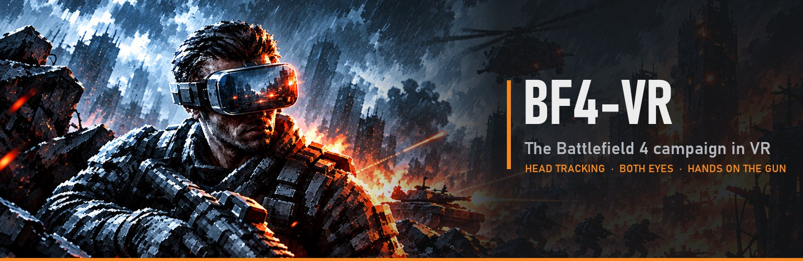

  <b>Play the Battlefield 4 single-player campaign in virtual reality</b> 
  Full head tracking, a picture for each eye, and the gun in your own hands.

  
  
  
  

---

## About

BF4-VR is a fan-made mod that turns the Battlefield 4 campaign into a VR game. You look around with your head,
aim with the controller in your hand, reload by grabbing a magazine and draw weapons from your hips and back.
Menus, loading screens and cutscenes appear on a large virtual screen that you point at with a laser.

It runs on a Meta Quest 3 through Steam Link and SteamVR, with your own copy of Battlefield 4 on PC.

## Features

**See it in VR**
- Both eyes rendered from the same game frame, with head tracking, leaning and peeking.
- A flat virtual screen for menus, loading screens and cutscenes, with a laser pointer for the menus.
- The HUD on its own layer: the minimap on your forearm, the ammo counter beside the gun, and each element
  switchable on or off.

**Your hands**
- Arms follow the controllers and hold the gun; shots leave the barrel where it points.
- Two-handed grip, free hands, and holsters on your body for weapon swaps.
- Physical reloads, grenades with a pin to pull, melee and using objects by reaching for them.
- Controller rumble that follows the game.

**Comfort and setup**
- Snap or smooth turning, crouching from the stick or by really crouching, and a T-pose body calibration.
- An in-VR settings panel, plus a desktop launcher for installing, configuring and starting.
- Every button can be remapped.

## Screenshots

  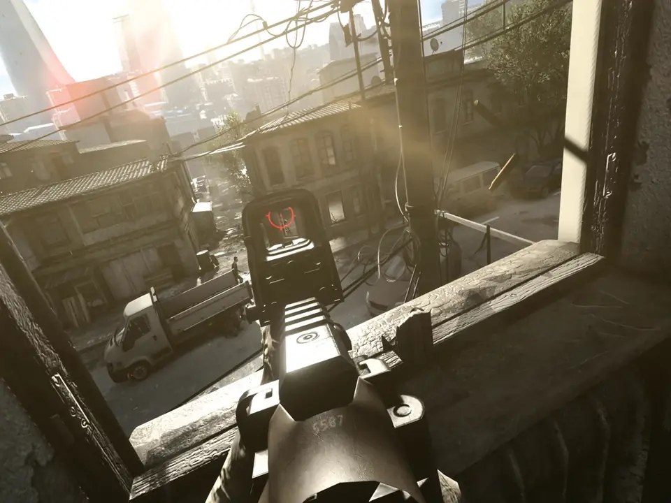
   Captured in the headset, Baku (Quest 3, 2026-11-13)

<table>
  <tr>
    <td></td>
    <td>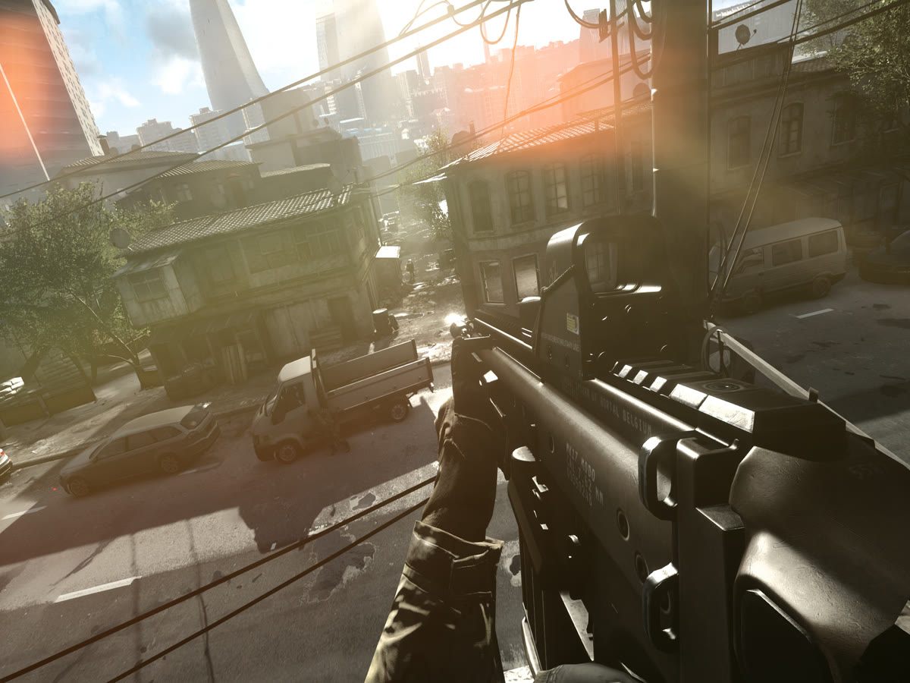</td>
    <td>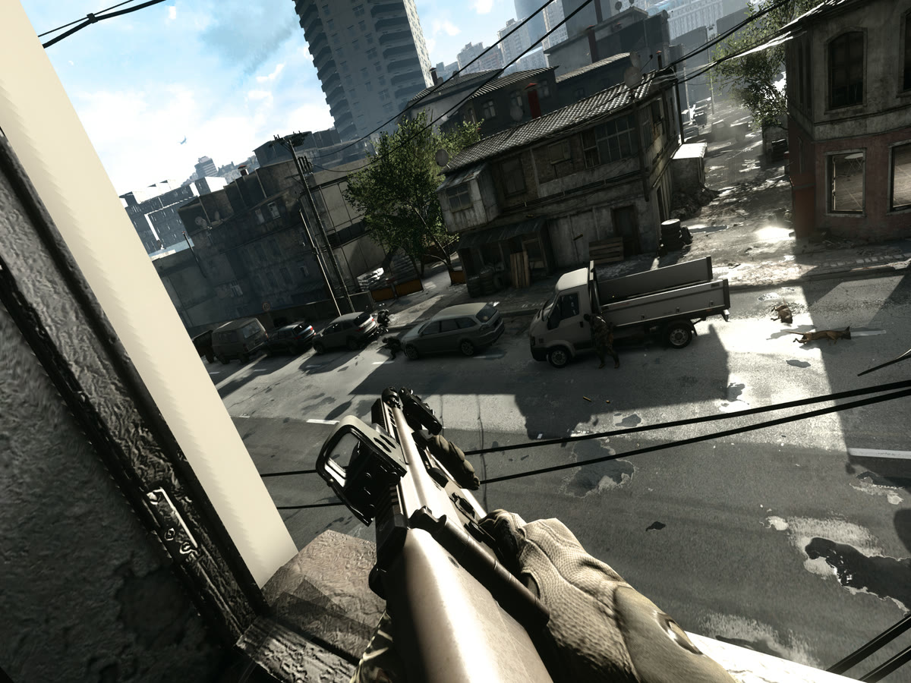</td>
  </tr>
  <tr>
    <td>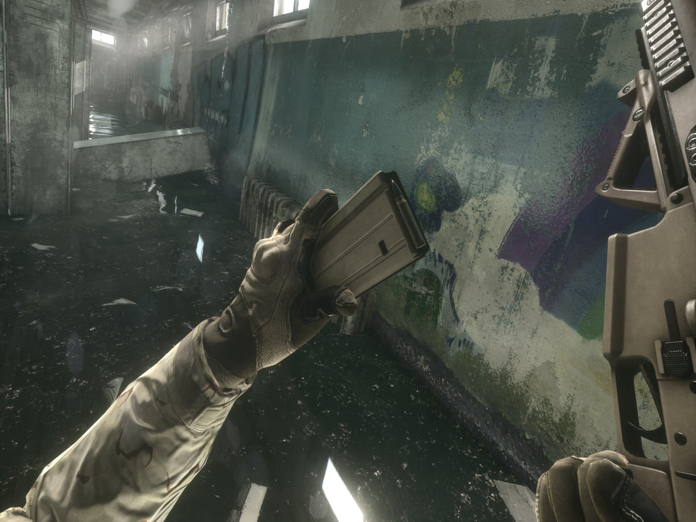</td>
    <td>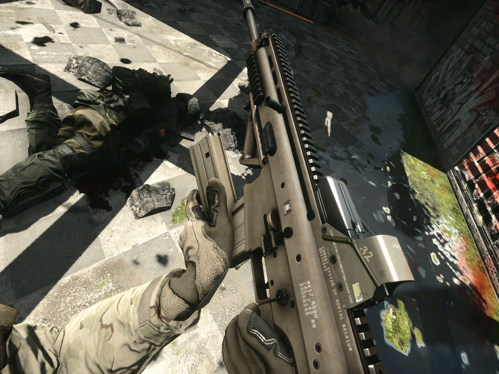</td>
    <td>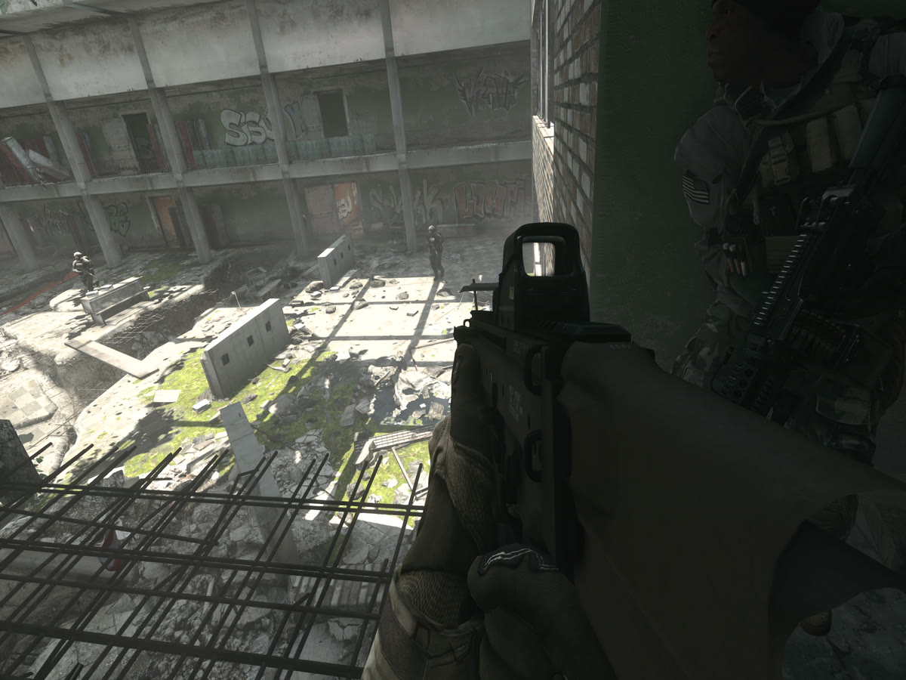</td>
  </tr>
</table>

  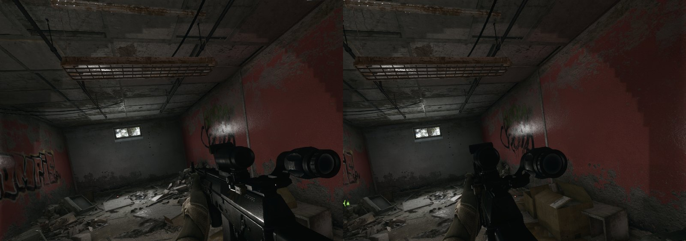
   A picture for each eye, rendered from the same game frame

  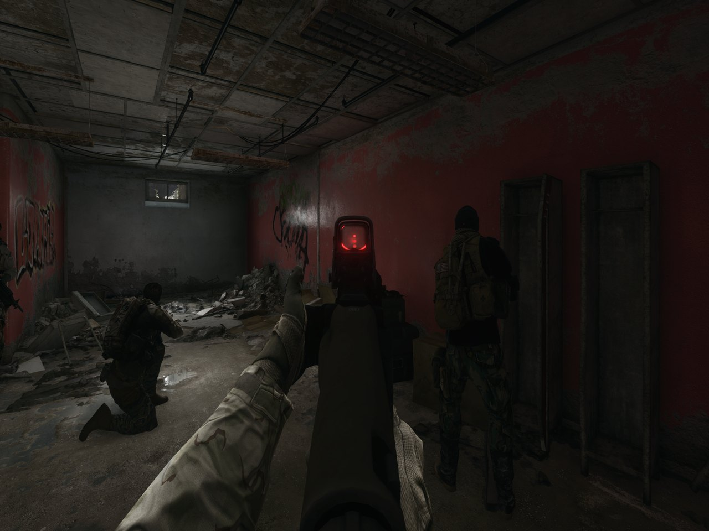
   Both hands on the rifle, aiming through the sight

  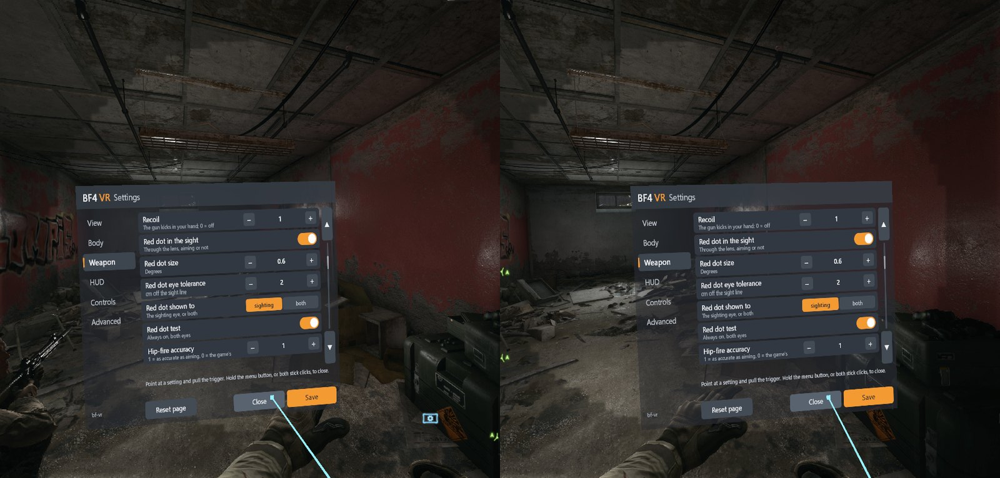
   Every setting is reachable from inside VR

## Status

The campaign is **playable in VR with physical gun handling**. Still open: magnified scopes and sights, laser
sights, some gadgets, and proper models for the grab zones. Progress and plans are tracked in the
[roadmap issue](https://github.com/DanInDev/bf4-vr/issues/21); headset test results are in
[docs/HEADSET-TESTS.md](docs/HEADSET-TESTS.md).

## Requirements

- Windows 10 or 11 and a VR-capable PC.
- Battlefield 4 on PC through the EA app (the campaign, game build 179547).
- A Meta Quest 3 connected through **Steam Link** (SteamVR). Meta Horizon Link works as a fallback.

## Getting started

  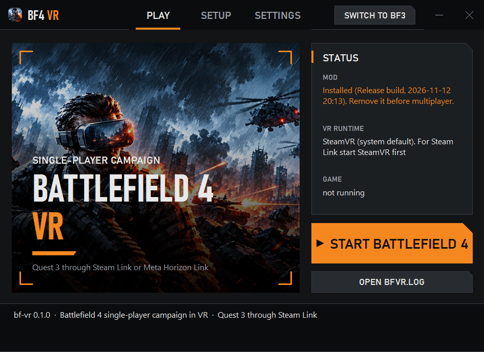

1. **Get the mod.** There is no public download yet; build it from source
   ([build instructions](docs/architecture/README.md#build-and-run)).
2. **Open the launcher** (`bfvr_launcher.exe`). On **Setup** it finds Battlefield 4, checks the game build and
   installs the mod. **Settings** has every option, the same as the panel inside VR.
3. **Start SteamVR and connect the Quest** through Steam Link.
4. Press **Start Battlefield 4** and continue your campaign.

> [!IMPORTANT]
> BF4-VR is for the **single-player campaign only**. It switches itself off outside the campaign, but always
> use **Remove mod** in the launcher before playing multiplayer. See [docs/SAFETY.md](docs/SAFETY.md).

## Controls

Grab by putting a hand into a zone and squeezing its grip.

Hold the left menu button (≡) for the settings panel inside VR. Buttons can be remapped on its Controls page
or in the launcher, with presets such as "Jump on B, reload on A". The full controller mapping for menus is in
the [technical notes](docs/architecture/README.md#controller-mapping-in-menus-theater-mode).

## For developers

The technical side lives in **[docs/architecture/](docs/architecture/README.md)**: how the mod is built, how it
works with the Frostbite engine, the reverse-engineering notes, the tools and the development loop. Read
[docs/SAFETY.md](docs/SAFETY.md) before running anything.

Battlefield 3 and multiplayer through Venice Unleashed are researched in a separate repository.

## Disclaimer

BF4-VR is a fan project. It is not affiliated with or endorsed by Electronic Arts or DICE. Battlefield is a
trademark of Electronic Arts. You need your own copy of Battlefield 4; the mod ships only its own code and
contains no game files.
