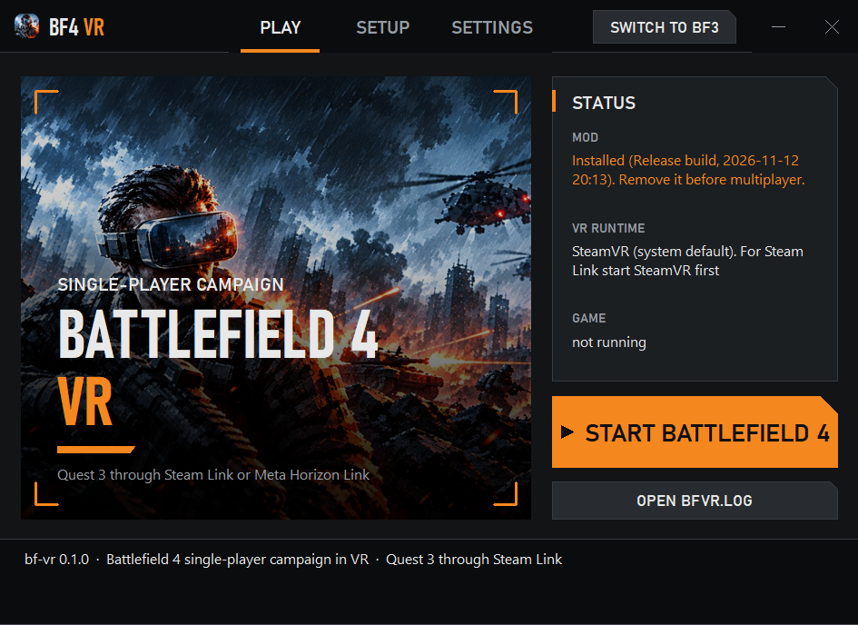

# Installing BF4-VR with the launcher

From a fresh PC to the Battlefield 4 campaign in the headset, step by step. Campaign only: read the
safety box at the end before you play anything else.

## What you need

- Windows 10 or 11 and a VR-capable PC.
- **Battlefield 4 from the EA app**, the final game build **179547** (what the EA app installs today).
- A **Meta Quest 3** with **Steam Link** (SteamVR on the PC). Meta Horizon Link works as a fallback.
- The mod: the zip from the [releases page](https://github.com/DanInDev/bf4-vr/releases) (`bf-vr-<version>.zip`),
  or your own build (`build\bf4\Release` after `cmake --build --preset bf4-release`; `tools\package.ps1` makes the zip).

## 1. Start Battlefield 4 once without the mod

If you have never started BF4 on this PC, start it from the EA app, wait for the main menu and quit.
That creates `Documents\Battlefield 4\settings\PROFSAVE_profile`, the game's own settings, which the
launcher adjusts for VR.

## 2. Unzip and open the launcher

Unzip anywhere **except** the BF4 folder (for example `Documents\bf-vr`) and run `bfvr_launcher.exe`.
`dinput8.dll` and `bfvr.ini.example` must stay beside it.

## 3. Setup tab: one click

1. **Battlefield 4 / Folder**: the launcher finds BF4 through the registry. If the folder is wrong or
   empty, use **Change...** and pick the folder that holds `bf4.exe`.
2. **Build** must say 179547. Any other build is refused; the mod's addresses only fit that one.
3. Close BF4 if it is running, then press **Set up for VR**. It does three things and reports each:
   - copies the mod (`dinput8.dll`) into the BF4 folder, with a marker so only the launcher's copy is ever removed;
   - writes the VR values into `bfvr.ini` in the BF4 folder (head-tracked 3D, a 2160x2160 image per eye,
     the view crop, the HUD layer); your other settings in it are kept;
   - changes BF4's own settings that VR needs: DirectX 11 (Mantle off), **post anti-aliasing off** (it blurs the
     whole headset image), no weapon depth of field, no motion blur, vsync off, pad vibration on. Your normal
     settings are kept for normal mode (below).

   The **VR setup** lines turn green once nothing is left to change, and show which VR runtime the mod will use.

## 4. Settings tab (optional)

Every mod option, the same pages as the panel inside VR (View, Body, Weapon, HUD, Controls, Skeleton,
Advanced). **Save** writes `bfvr.ini`. You can change all of this later inside VR too.

## 5. Play

1. Start **SteamVR** and connect the Quest through **Steam Link** (or Horizon Link).
2. On the **Play** tab, the VR runtime line should name SteamVR (or Oculus). Press **Start Battlefield 4**: the
   launch goes through the EA app, BF4 opens about a minute later.
3. Continue your campaign. The first time a level loads you are asked for a **body calibration**: stand
   straight, arms out in a T, and hold both triggers for two seconds. Redo it any time from the panel
   (Body > Calibrate now).
4. In VR, **hold the left menu button (≡)** for the mod's settings panel. Controls:
   [quest3-controls.svg](img/quest3-controls.svg); grab zones: [grab-zones.svg](img/grab-zones.svg).

## Normal mode and VR mode

The **VR mode** switch on the Play tab flips between playing BF4 in VR and playing it normally on the monitor,
for example to reach a part of the campaign with mouse and keyboard and then go on in VR. Close BF4 first.
Each mode keeps its own copy of BF4's video, audio and control settings: switching saves the current ones
(`PROFSAVE_profile.bfvr-normal` or `.bfvr-vr` in `Documents\Battlefield 4\settings`, plain text files you may
edit while BF4 is closed) and brings back the other mode's, then installs or removes the mod. What you change
in BF4's options stays with the mode you changed it in. Campaign progress is shared: Resume continues from
the last checkpoint in either mode.

## Picture quality

BF4's own **Options > Video** still apply on top of the mod:

- **Resolution Scale** (Advanced): renders more pixels than the 2160x2160 image and scales them down. Sharper
  far away; costs frame time roughly with the pixel count (125% is about 1.6 times the pixels). Raise it in steps
  while the headset still holds its refresh rate.
- **Antialiasing Post** stays **Off** (the setup sets it). **Antialiasing Deferred** (MSAA) smooths edges without
  blurring; 2x or 4x if the frame rate allows.
- Steam Link's own streaming quality (bitrate, codec) also decides how sharp distant detail looks.

## Updating

Get the new zip (or build), unzip it over the old launcher folder, BF4 closed, and press **Update mod** on the
Setup tab (or **Set up for VR** again). **Updates?** asks GitHub whether a newer release exists.

## Removing

Switch **VR mode** off on the Play tab: it deletes `dinput8.dll` from the BF4 folder and brings back your normal
settings. (**Remove mod** on the Setup tab removes only the DLL.) `bfvr.ini` and `bfvr.log` stay in the BF4 folder as plain text; delete them if you like.

> [!IMPORTANT]
> **Campaign only.** The mod switches itself off outside the campaign, but always press **Remove mod** before
> joining any multiplayer server: PunkBuster bans for foreign DLLs. Never run it alongside games with kernel
> anti-cheat (Battlefield 6, EasyAntiCheat titles). Details: [SAFETY.md](SAFETY.md).

## When something goes wrong

- **Play** tab, **Open bfvr.log**: the mod's log from the BF4 folder.
- Nothing in the headset: start SteamVR before BF4 (the mod picks SteamVR only when it is already running;
  the Play tab's runtime line shows which one it will use).
- "another mod's dinput8.dll": a different mod uses the same file; remove it first.
- Anything else in the game folder: the EA app's **Repair** restores the original game files.
